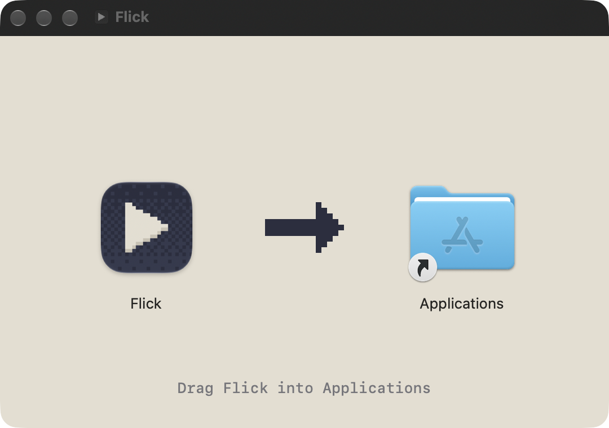
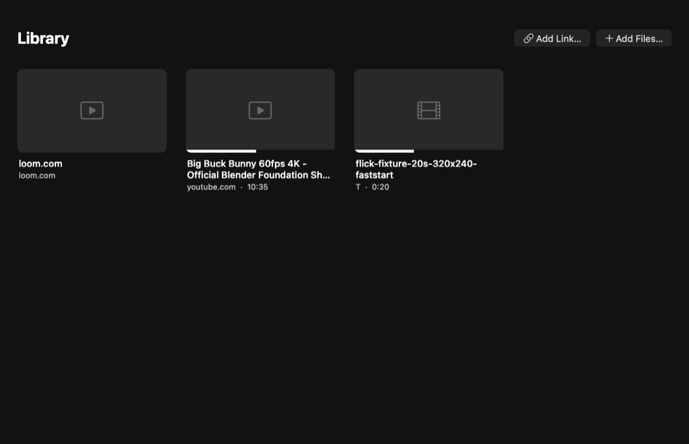

# Flick

A fast, quiet video player for macOS. Native AppKit UI on top of [libmpv](https://mpv.io), so it plays everything mpv plays (MP4, MKV, WebM, HEVC, AV1, VP9…) with hardware decoding, plus links from YouTube, Loom, Vimeo and the other sites [yt-dlp](https://github.com/yt-dlp/yt-dlp) supports.

## Install

1. Download **Flick-*version*.dmg** from the [latest release](https://github.com/betterCallHex/flick/releases/latest)
2. Open it and drag **Flick** into **Applications**
3. Open Flick from Applications



Needs macOS 15 Sequoia or later on Apple Silicon. Everything Flick needs to play files is inside the app. To play web links, also install yt-dlp (`brew install yt-dlp`); Flick tells you when it's missing.

### Homebrew

```sh
brew trust --tap betterCallHex/tap   # Homebrew 7+ only loads taps you trust
brew install --cask betterCallHex/tap/flick
```

This also installs yt-dlp.

**First launch (DMG or Homebrew):** Flick is free and not signed with a paid Apple Developer ID, so macOS will say it *"could not verify Flick"*. Click **Done**, then go to **System Settings → Privacy & Security**, scroll down and click **Open Anyway** next to Flick. You only need to do this once; updates install without asking.

Prefer the Terminal? This does the same thing:

```sh
xattr -dr com.apple.quarantine /Applications/Flick.app && open /Applications/Flick.app
```

## Library

Everything you play, whether a file or a YouTube, Loom or other link, goes into the library with its title, thumbnail and how far you got. Open Flick without a video to see it, or press ⌘L while watching (⌘L or Esc takes you back). **Add Link…** and **Add Files…** save things to watch later without playing them. Right-click an item to remove it, copy its link or show the file in Finder. The library is stored in `~/Library/Application Support/Flick/library.json`.



## Speed

`make bench` launches the app on 1080p H.264, 4K HEVC (MKV) and 720p VP9 (WebM) files and measures the time from `open` to the first frame visible on screen. The check fails above 1000 ms.

Measured on an M4 MacBook Air, macOS 27:

| File | Launch → visible first frame |
|---|---|
| 1080p H.264 MP4 | 391–426 ms |
| 4K HEVC MKV | 408–450 ms |
| 720p VP9 WebM | 364–431 ms |
| First launch of a freshly built app (one-time signature check) | 655–1220 ms |

## Build

Requires the Xcode command line tools, Homebrew mpv, and yt-dlp for web links (and [uv](https://docs.astral.sh/uv/) for `make release`, which runs `dmgbuild` through `uvx`):

```sh
brew install mpv pkg-config yt-dlp
make app        # build/Flick.app
make test       # unit + headless mpv integration tests
make test-web   # also plays real YouTube and Loom links (needs network)
make bench      # launch-time budget check
make check      # test + bench
make install    # copy to ~/Applications
make icon       # regenerate Resources/AppIcon.icns from scripts/make-icon.swift
make dmg-background  # regenerate the DMG window background
make release    # build, sign the update, publish a GitHub release, update the cask
```

To try a build in the running app without taking over the screen, `scripts/drive.sh start [file-or-link]` launches a muted copy named FlickDrive in the background, with its own library and settings; `scripts/drive.sh shot out.png` screenshots its window and `scripts/drive.sh stop` quits it and deletes its data. Drive its controls with `agent-desktop` (`agent-desktop snapshot --app FlickDrive`).

The app icon is 32×32 pixel art in four muted colours, drawn in code (`scripts/make-icon.swift`), clipped to Apple's icon shape so macOS shows it full size. To use other artwork, replace `Resources/AppIcon.icns`.

To make Flick the default player: Finder → select a video → Get Info → Open with: Flick → Change All.

## Updates

Flick updates itself with [Sparkle](https://sparkle-project.org). It checks GitHub once a day, downloads a new release in the background and installs it when you quit. Flick → Check for Updates… checks now.

The feed is `appcast.xml` attached to the latest GitHub release (`releases/latest/download/appcast.xml`). Every update is signed with an EdDSA key; the public half is `SUPublicEDKey` in `Info.plist` and the private half lives in the login Keychain under the account `flick` (Sparkle's `generate_keys --account flick`). Back it up with `.build/artifacts/sparkle/Sparkle/bin/generate_keys --account flick -x flick-update-key`; without it no installed copy can be updated again.

To ship a version:

1. Raise `CFBundleShortVersionString` and `CFBundleVersion` in `Resources/Info.plist` and commit.
2. `make release` builds the app, zips it, writes a signed `appcast.xml`, builds `Flick-<version>.dmg`, pushes the branch, runs `gh release create v<version>` with all three files, and bumps `version` and `sha256` in `Casks/flick.rb` of [betterCallHex/homebrew-tap](https://github.com/betterCallHex/homebrew-tap).

`make app` copies libmpv and every Homebrew library it links (about 50, 60 MB) into `Contents/Frameworks` and points them at `@rpath` (`scripts/bundle-libs.py`), so the app runs on a Mac without Homebrew. The build stops if any library still links outside the app. Homebrew's libraries are arm64-only, so the app is too.

The app is ad-hoc signed, not notarized. Sparkle installs updates without Gatekeeper getting involved; a first download needs **Open Anyway** (see Install).

## Web videos

Paste a link with ⌘V anywhere in the window, use File → Open URL… (⇧⌘O), or drag a link from the browser onto the window. Public YouTube, Loom, Vimeo, Google Drive and Dropbox links work, and so does any direct `.mp4`/`.m3u8` URL.

Links to pages go through yt-dlp first (`ytdl://`). Direct media links skip it. A YouTube link takes 4–6 s to start, almost all of it yt-dlp talking to YouTube. Loom signs its stream segments with a CloudFront policy that mpv's yt-dlp bridge does not forward, so Flick hooks `on_load` and passes the signature as CloudFront cookies (`SignedSegments` in `WebVideo.swift`).

To change the quality, click the resolution (for example **1080p**) in the control bar and pick one of the sizes the site offers, or **Auto** for the best. Flick asks yt-dlp again for the largest stream at or below that size (`format-sort=res:N`) and picks up where you were, so a switch takes as long as opening the link. The choice stays for the next links you open until you quit.

Private videos (a Loom or Drive file that needs you signed in) are not supported yet.

## Controls

| | |
|---|---|
| Space, click | Play / pause |
| Double-click, F, pinch out | Full screen (Esc or pinch in to leave) |
| ← / → | Back / forward 5 s |
| ⇧← / ⇧→ | Back / forward 30 s |
| ⌥← / ⌥→ | Back / forward 1 s |
| , / . | Previous / next frame |
| ↑ / ↓ | Volume |
| M | Mute |
| C, captions button | Subtitles on / off |
| [ / ] / \\ | Slower / faster / normal speed |
| Two-finger swipe left / right | Seek |
| Two-finger swipe up / down | Volume |
| Drag the window anywhere | Move it |
| Drop a file on the window or Dock icon | Open it |
| ⌘V, drop a link | Play a web video |
| ⇧⌘O | Open URL… |

Controls, title bar and cursor fade out after 2 s of playback without mouse movement. Every file resumes where you left it, unless you were in its first or last 5 seconds. Subtitles next to the video (fuzzy name match) load automatically. C turns subtitles on or off for local files and web links alike, and Flick remembers the choice. Turning them on when a video has subtitles but none selected (YouTube's usually) picks the track in your system language, else the first one. Web links bring captions in your system languages plus English, including YouTube's auto-generated ones; the captions button only appears when the video has some. Subtitles move up above the control bar while it is showing.

## Layout

- `Sources/Flick/Mpv.swift`: thin libmpv client wrapper (options, commands, properties, events).
- `Sources/Flick/Player.swift`: playback state and commands, resume rules.
- `Sources/Flick/VideoLayer.swift`: mpv render API on a `CAOpenGLLayer`.
- `Sources/Flick/PlayerWindowController.swift`: window sizing, auto-hiding chrome, mouse and trackpad input.
- `Sources/Flick/ControlsView.swift`: control bar, scrubber, labels.
- `Sources/Flick/Subtitles.swift`: subtitle track list, preferred-language pick, yt-dlp caption languages.
- `Sources/Flick/WebVideo.swift`: link parsing, yt-dlp routing, CloudFront cookie fix, Homebrew PATH for yt-dlp.
- `Sources/Flick/App.swift`: app delegate, menus (all keyboard shortcuts live here), Sparkle updater, first-frame probe used by `make bench`, `FLICK_DRIVE_DIR` launch mode used by `scripts/drive.sh`.
- `scripts/bundle-libs.py`: copies libmpv and its Homebrew dependencies into the app.
- `scripts/drive.sh`: muted background copy of the app for agents and manual checks; `scripts/window-id.swift` finds its window.
- `scripts/release.sh`: zips the app, signs the appcast, builds the DMG, publishes the GitHub release and updates the Homebrew cask.
